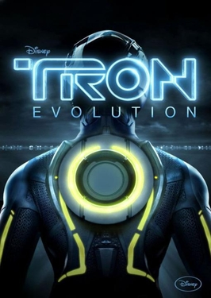

# TRON: Evolution — Renderer Vulkan / FPS Unlock / Portable

[Русский](README.md) | [English](README.en.md)

**TRON: Evolution Patcher** is a lightweight binary modification and configurator tool for *TRON: Evolution* (Unreal Engine 3, 32-bit x86). It enables native **Vulkan** rendering via **DXVK 3.1.1** with 1-click rollback to **DirectX 9**, framerate uncapping (up to 120/144/165/200 FPS), custom resolutions (2K QHD / 4K UHD / DLDSR), and 100% portable saves without Windows Registry or Documents folder dependencies.

**Version:** 1.0.0  
**Author:** [CodoMagia](https://github.com/codomagia)  
**Discussion / Community:** [Telegram (codomagia)](https://t.me/codomagia/23)  
**Support the author:** [Boosty](https://boosty.to/codomagia/donate)  

Pre-built binaries are available in [Releases](https://github.com/codomagia/Tron-Evolution/releases).

---

## Screenshot

---

### Why choose this patcher?

- **Smooth Frametimes & Reduced Input Latency (Vulkan / DXVK 3.1.1):** Native DirectX 9 in legacy games suffers from driver overhead and micro-stutters on modern GPUs. DXVK translates D3D9 calls directly into Vulkan, delivering solid frame pacing and responsive controls.
- **Surgical 8-Byte IAT Modification:** No fragile memory hooking or DLL injection. The patcher replaces exactly 8 bytes in `GridGame.exe`'s PE Import Address Table (`d3d9.dll\0` ↔ `vk09.dll\0`). The string length is identical, preserving section alignment and entry points.
- **Framerate Unlock with Physics Protection:** Unreal Engine 3 hard-caps TRON: Evolution to 62 FPS by default. The patcher safely allows 120, 144, 165, or 200 FPS for high-refresh gaming displays without breaking lightcycle stages or script triggers.
- **100% Portable (Standalone Launch):** Allows the game to run seamlessly as a fully self-contained portable application without Windows registry dependencies or administrator privileges. Ideal for external drives and USB sticks.
- **Self-Sufficient UserData Save Redirection:** Incorporates a 432-byte code cave that recursively generates all directory trees for saves (`CHECKPT`), logs (`Launch.log`), and `.ini` configs inside `<GameRoot>\UserData`. No files or clutter left in the system Documents folder.
- **Safety & 1-Click Rollback:** Automatically generates a clean backup (`GridGame.exe.bak_d3d9`). Reverting back to native DirectX 9 is always one click away.

---

### Key Features:

- ⚡ **1-Click Graphics API Switching** — Toggle seamlessly between Vulkan (DXVK) and DirectX 9.
- 🎯 **Framerate / FPS Limiter** — Presets for 62, 120, 144, 165, 200 FPS, Uncapped mode, or custom values.
- 🖥️ **Custom Resolution Support (Pure .INI)** — 2K QHD (2560x1440), DLDSR (2880x1620), 4K UHD (3840x2160), Full HD 1080p, with automatic Read-Only lock to prevent in-game resets.
- 🚀 **Full Portability** — Bypasses registry checks and redirects save files directly into the game directory.
- 📊 **DXVK HUD Overlay** — Real-time display of FPS, GPU load, temperature, and VRAM budget.
- 🎨 **Forced 16x Anisotropic Filtering** — Crisp texture clarity via DXVK sampler overrides.
- 🔍 **Auto-Discovery** — Automatically detects standard portable and installed Tron Evolution locations.
- ▶ **Direct Launch** — Launch the game directly from the patcher UI.

---

### Quick Start:

1. Download `TronEvolutionPatcher-1.0.0.zip` from [Releases](https://github.com/codomagia/Tron-Evolution/releases/latest).
2. Extract the entire archive into any directory (or directly into your game folder), keeping the `Assets` folder alongside the EXE.
3. Run `TronEvolutionPatcher.exe`.
4. The patcher will auto-detect your game installation (or click **«Browse…»** to select manually).
5. Click **«⚡ Switch to Vulkan»**, pick your resolution and FPS, then click **«💾 Apply Settings»**.
6. Click **«▶ Launch Game»**!

---

## Requirements

- **OS:** Windows 10 or Windows 11 (64-bit)
- **Patcher platform:** C# / WPF, .NET Framework 4.7.2 or a compatible later runtime
- **GPU:** Any graphics card supporting Vulkan 1.3+ (NVIDIA GeForce 900+, AMD Radeon RX 400+, Intel Arc / Iris Xe)
- **Target Application:** TRON: Evolution (Win32Live version)

---

## Source code

The patcher is open source: C# / WPF sources are in `src`, tests are in `tests`, and the solution is `TronEvolutionPatcher.sln`. Python is not required to build or run it. [Build and test instructions](docs/BUILD.en.md).

---

## License

Distributed under the open-source MIT License.  
Copyright © 2026 CodoMagia. All rights reserved.  
DXVK is distributed under the zlib/libpng license.
