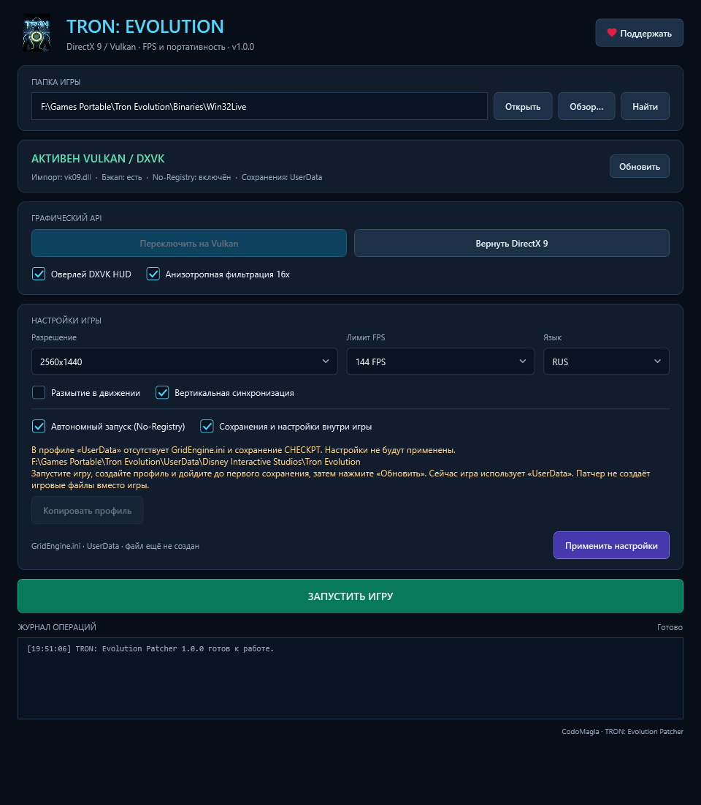

# Отсутствующий профиль и перенос сохранений

Патчер не генерирует пользовательский GridEngine.ini из DefaultEngine.ini и не создаёт CHECKPT вместо игры. Ранее создание INI из шаблона с последующей защитой Read-Only могло оставлять неполный профиль; этот путь удалён.

## Проверка перед применением

Проверяются два расположения `Disney Interactive Studios/Tron Evolution`: в системных «Документах» и в `<GameRoot>/UserData`.

Для применения настроек выбранный профиль должен содержать:

- Непустой `UnrealEngine3/GridGame/Config/GridEngine.ini`.
- Непустой файл `CHECKPT` внутри `SaveData`.

Клавиатурные настройки и пустой CHECKPT не заменяют сохранение. Проверка наличия не является полной проверкой бинарного формата или пригодности профиля для конкретной сборки игры. Патчер не утверждает, что профиль исправен только по этим признакам.

Проверка повторяется непосредственно перед применением, до записи No-Registry/UserData, INI и DXVK. Удаление сохранения после загрузки окна также блокирует последующее применение. Состояние двух профилей показывается в предупреждении; выбор галочки UserData меняет назначение проверки и копирования.

## Если профиля нет

Запустите игру обычной кнопкой запуска, создайте профиль и дойдите до первого сохранения. Затем нажмите «Обновить». Игра запускается с фактически действующим расположением профиля: ещё не применённая галочка UserData его не переключает. Патчер показывает, какое расположение использует игра сейчас.

При желании после создания профиля можно скопировать его в другое расположение и применить редирект. Переключение рендера остаётся отдельной операцией; автоматического запуска игры, восстановления архива или перезаписи неполного профиля нет.

## Явное копирование

Кнопка «Копировать профиль» доступна, когда другое расположение содержит INI и CHECKPT, а выбранное назначение не содержит файлов. Направление задаётся галочкой «Сохранения и настройки внутри игры»: включена — из «Документов» в UserData, выключена — обратно.

Копируются файлы верхнего уровня Config и дерево SaveData. Источник остаётся на месте, его атрибуты и содержимое не меняются. Само копирование не патчит EXE и не применяет настройки. После него нажмите «Применить настройки».

Если назначение непустое, автоматическое смешивание запрещено, включая случай одного ранее созданного INI или логов без сохранений. Можно выбрать другое существующее расположение либо самостоятельно сохранить неполную папку отдельно перед копированием. Патчер ничего из неё не удаляет. Ошибки установки файлов приводят к откату скопированного и удалению только новых пустых каталогов; при ошибке отката сохраняется каталог восстановления.

