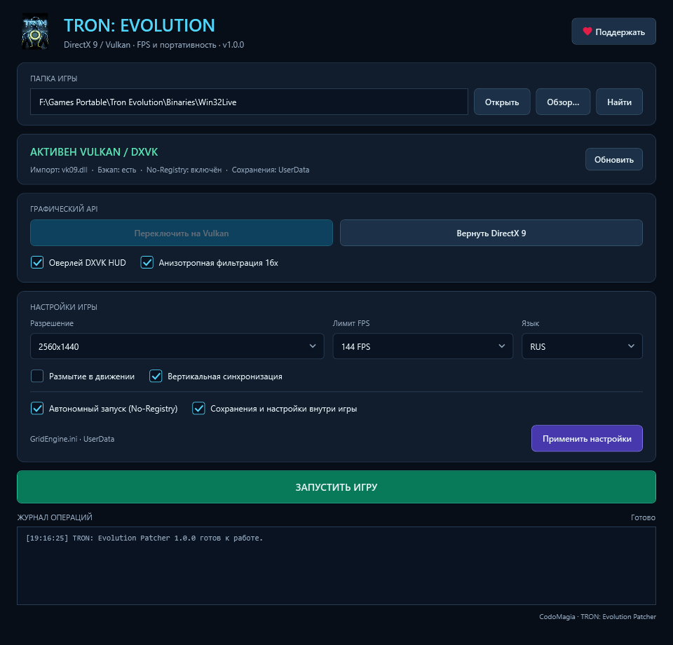

# WPF-интерфейс



Снимок показывает демонстрационные значения, а не запущенную игровую копию.

## Возможности

- Ввод корня игры, Win32Live или пути к GridGame.exe; «Открыть», Enter и системный диалог «Обзор…».
- Автопоиск при старте и кнопкой «Найти»: папка приложения и два родительских уровня,
  включая Games Portable/Tron Evolution относительно каждого кандидата. Фиксированных дисков и полного сканирования нет.
- Статус рендера, backup, No-Registry, профиля сохранений; ручное обновление состояния.
- Переключение DirectX/Vulkan с включённым в сборку payload.
- HUD и анизотропия: в Vulkan сохраняются сразу, в DirectX остаются выбором для следующего включения Vulkan.
- Разрешение и FPS с пресетами и произвольным вводом, RUS/INT и другие трёхбуквенные коды языка,
  Motion Blur, VSync, No-Registry, UserData, применение настроек, запуск игры и ссылка поддержки.
- Баннер ошибок и выделяемый журнал с временем последних 200 записей.
- Проверка наличия пользовательского INI и CHECKPT, предупреждение до записи и отдельное копирование профиля между «Документами» и UserData без перезаписи. См. [GAME_PROFILES.md](GAME_PROFILES.md).

Окно имеет прокрутку и поддерживает уменьшение до 760×560. Обычное закрытие блокируется на время операции записи;
сообщение об этом добавляется в журнал без дополнительного подтверждения.

## Команды и состояние

MainViewModel использует IPatcherBackend и IDesktopInteraction. Дисковые операции выполняются через Task.Run,
а привязки и уведомления обновляются в UI-контексте после await. AsyncCommand и общий IsBusy предотвращают
повторные и перекрывающиеся команды; на время операции недоступны выбор другой игры и редактирование.

Если пользователь изменил строку пути, действия с прежней выбранной игрой отключаются до «Открыть».
Если рендер неизвестен, запись и запуск отключены. Ошибка чтения INI отключает применение настроек,
сохраняя возможность обновить статус, переключить рендер и запустить известную игру.

Загрузка значений из состояния не вызывает запись DXVK. Автоматическое изменение HUD/анизотропии
не сбрасывает черновики разрешения или portable-флагов, в том числе при ошибке записи конфигурации.
Ошибки после операций сопровождаются перечитыванием состояния; форма не продолжает показывать прежнее
состояние патча как текущее.

Пакет «Применить настройки» последовательно меняет portable-патчи при необходимости, INI и DXVK для Vulkan.
Каждый сервис имеет собственный откат, но весь пакет не является одной транзакцией. Если поздний шаг не выполнен,
ошибка явно перечисляет уже выполненные шаги. После неё состояние перечитывается и показывает реальный результат.

Профиль INI выбирается по фактическому редиректу UserData. Это исправляет ситуацию исходного автоматического
приоритета, когда оставшийся portable-INI перехватывал запись после выключения редиректа.

## Проверки

- Тесты ViewModel используют подставные backend и диалоги: доступность команд, IsBusy, повторные действия,
  валидацию, ошибки чтения, частичный результат, живое обновление DXVK и запуск без реальных процессов.
- Интеграционные тесты фасада проверяют выбор активного INI, относительный автопоиск, частичный результат,
  поставляемую DLL и лицензионные файлы на временных данных.
- WPF smoke-тест проверяет стартовое окно, ресурсы, DataContext, привязку пути, редактируемый ComboBox
  и отключённый запуск без игры.
- Скрипт `scripts/Render-Preview.ps1` создаёт изображения окна без Show/Run, файлов игры и выполнения команд.
  Режим по умолчанию подставляет демонстрационное состояние; -Empty оставляет начальный экран.
  Ошибки привязок уровня Warning/Error завершают скрипт с ошибкой.

```powershell
powershell.exe -NoProfile -STA -ExecutionPolicy Bypass -File .\scripts\Render-Preview.ps1 -Height 920
powershell.exe -NoProfile -STA -ExecutionPolicy Bypass -File .\scripts\Render-Preview.ps1 -Width 760 -Height 600
powershell.exe -NoProfile -STA -ExecutionPolicy Bypass -File .\scripts\Render-Preview.ps1 -Empty -Height 920
```

Результаты находятся в artifacts/ui (не входят в Git); проверенный пример сохранён в docs/images/ui.png.
Скрипт сохранён в UTF-8 с BOM для Windows PowerShell 5.1.
Переключение и запуск на отдельной реальной копии игры ещё не проверялись; это следующий интеграционный этап.
